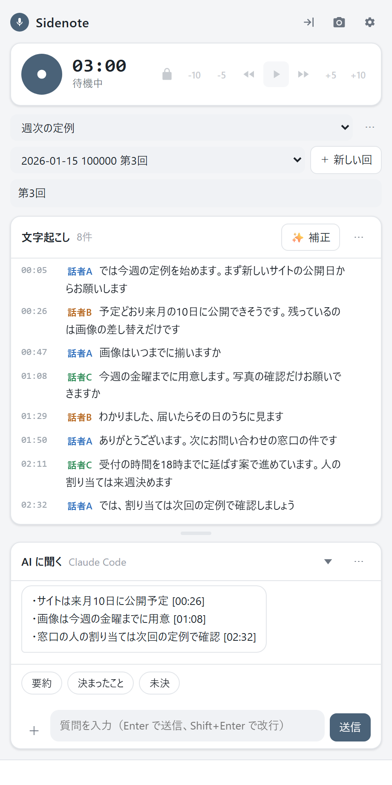
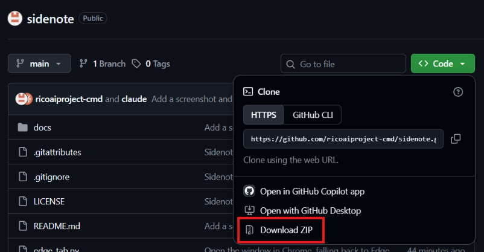

# Sidenote

A Windows side panel that transcribes meetings on your PC and lets you ask AI about them. (Documentation is in Japanese.)



対面の会議や Web 会議を聞きながら文字にして、画面の右端に出す Windows 用の道具です。
会議の途中でも「ここまでを要約して」「決まったことは？」と AI に聞けます。AI は Claude Code、API キー（Claude・OpenAI・Gemini など）、パソコンの中で動くローカル LLM から選べます。

- **声と録音は、このパソコンの中だけで扱います。** 文字起こしはパソコンの中の音声認識（speech.cpp）で行います。
- AI に渡るのは、質問したとき・補正したとき・engram へ送ったときの文字起こしと、添付した資料です。録音は渡しません。ローカル LLM を選べば、パソコンの外へ出ません。添付した画像や資料の原本を読むのは、接続先が Claude Code のときだけです（ほかの接続先には、資料から取り出した文字だけを渡します）。
- 個人情報などを含む発言は、押してグレーにすると AI に渡さなくなります。判定のボタンで、まとめて候補を見つけることもできます。グレーにできるのは発言だけです。添付した資料の中身、話者の名前、会議の題名は渡ります。
- Web 検索とコネクタは、接続先が Claude Code のときに、質問欄のスイッチを入れた場合だけ使います。初めは切れています。

> 非公式の個人開発の道具です。Anthropic とは関係ありません。

## できること

| 機能 | 内容 |
|---|---|
| 文字起こし | マイクの音を聞き続けて、発言ごとに文字にする。話者（話者A・B…）も分ける |
| Web 会議 | 設定の「拾う音」で、パソコンから出る音（相手の声）もマイクと一緒に録って文字にする |
| 窓を隠す | 上のボタンで窓を隠し、画面の右端の小さなつまみだけにする。記録は続く |
| 質問 | 文字起こしと添付した資料をもとに AI が答える（要約・決まったこと・未決のボタンあり） |
| 補正 | 聞き間違い・変換の誤りを、前後の文脈と資料から AI が直す（元の文も残る） |
| AI の接続先 | 右上の歯車で Claude Code・API キー・ローカル LLM・使わない、から選ぶ |
| 録音を聞く | 南京錠を解除すると、再生・一時停止、5秒と10秒の移動、早送りと巻き戻しができる。発言を押すと、その発言から聞ける |
| スクリーンショット | 上のカメラのボタンで、Sidenote の窓を写さずに画面を撮り、この回のフォルダに保存する |
| AI を止める | 答えを待つあいだ、送信ボタンが ■ に変わる。補正にも「■ 止める」が出る |
| 発言を伏せる | 施錠中に発言を押すか、発言の右端のボタンを押すとグレーになり、AI と engram に渡さない |
| 個人情報の判定 | 文字起こしの「⋯」→「個人情報を判定してグレーに」。このパソコンの中だけで電話番号・「〜さん」・病名などを探してグレーにする |
| 話者を直す | 発言の「話者A」を押すと、別の話者や名前に直せる（同じ話者をまとめて直すこともできる） |
| 話者の設定 | 文字起こしの「⋯」→「話者の設定」で、話者A は〇〇さん、を回ごとに決める。記録中に増える発言にも効く |
| 音声ファイルの文字起こし | 音声・動画のファイルを「文字起こし」の欄へドラッグすると、新しい回を作って文字にする |
| 雑音除去（任意） | 設定でオンにすると、文字起こしの「⋯」から、雑音を除いて文字にし直した別の版を作れる。AI は両方の版を見比べて答える |
| Web 検索・コネクタ（任意） | 接続先が Claude Code のとき、質問欄の「＋」のスイッチで Web 検索やコネクタ（読むだけ）を使わせる |
| 資料の添付 | PDF・Word・Excel・PowerPoint・画像を添付して、質問の手がかりにする |
| 会議名 | 同じ会議の回を1つのフォルダにまとめる。過去の回も含めて質問できる |
| 常駐 | Windows の起動時に裏で待機。窓を閉じても記録は続く |
| engram へ送る（任意） | [engram](#engram任意) がある人だけ。ボタンを押したときだけ要点を送る |

## 必要なもの

- Windows 10 / 11（x64）
- Google Chrome か Microsoft Edge（画面の表示に使います。Chrome があれば Chrome、無ければ Windows に最初から入っている Edge で開きます。いつものブラウザとは別の設定で開くので、ログインや拡張機能は影響しません）
- グラフィックのドライバー（NVIDIA・AMD・Intel のどれでも。文字起こしの speech.cpp が使う Vulkan が入っています）
- インターネット（セットアップと、API など外の AI を使うとき。文字起こしはパソコンの中で行います）
- 質問・補正を使う場合は、次のどれか1つ（**文字起こしだけならどれも不要**で、あとから足せます）。くわしくは「[AI の接続先](#ai-の接続先)」にあります。
  - [Claude Code](https://claude.com/claude-code) のアカウント（**ご自分のアカウントでログインしてください。** そのアカウントの利用枠を使います）
  - Claude・OpenAI・Gemini などの API キー
  - ローカル LLM（[Ollama](https://ollama.com/) か [LM Studio](https://lmstudio.ai/)）
  - 利用上限に達すると、その間は質問などが「失敗しました」と表示されます（文字起こしは続きます）。

ほかに必要なもの（Python、speech.cpp と音声認識モデル、ffmpeg）は、セットアップが自動で入れます。

## 入れ方

1. このページの右上にある緑の「Code」を押し、いちばん下の「Download ZIP」でダウンロードします（`git clone` でもかまいません）。

   

2. ダウンロードした ZIP を右クリック →「すべて展開」で、好きな場所に展開します。**ZIP の中のまま実行すると失敗します。**
3. 展開したフォルダの **`setup.bat` をダブルクリック**します。5〜15 分ほどかかります。
   - 「Windows によって PC が保護されました」という青い画面が出たら、**「詳細情報」→「実行」**を押してください。
     インターネットから取ってきた、署名の無いファイルに出る警告です。中身はこのページで公開しているとおりです。
   - 途中で「Claude Code を入れますか？」「ログインしますか？」と聞かれたら、`y` か `n` を打って Enter を押します。
     ログインを選ぶと別の窓とブラウザが開くので、そこでログインしてください。
4. 終わったら、スタートメニューの「Sidenote」から起動します。
   - 足りないものがあると、画面の上に「準備の確認」が出て、どうすればよいかを案内します。

`setup.bat` がやること（何度実行しても大丈夫です）：

| 順番 | 内容 |
|---|---|
| 1 | Python 3.11 以上が無ければ、winget で Python 3.12 を入れる |
| 2 | Python の部品（`requirements.txt`）を入れる |
| 3 | [speech.cpp](https://github.com/nyosegawa/speech.cpp) を公式のインストーラーで入れ（確かめた版に固定し、古い版は新しくし）、使うモデル（Haas-ja-v1.0・Silero VAD・Nemotron 3 Diarization・RE-USE）を先にダウンロードする（合わせて数百MB） |
| 4 | ffmpeg が無ければ、winget で入れる |
| 5 | Claude Code が無ければ、入れるかどうか聞く。入っていれば、ログインの窓を開くかどうか聞く |
| 6 | スタートメニューと、Windows の起動時に裏で待機させるスタートアップに「Sidenote」を登録する |

起動時に待機させたくない場合は、あとで `python install_shortcuts.py --remove` のあと `python install_shortcuts.py --no-startup` を実行してください。

## 使い方

1. スタートメニューの「Sidenote」を開くと、画面の右端に縦長の窓が出ます。
2. ● のボタンを押すと記録が始まります。**記録中はボタンと通知領域のアイコンが橙色になり、● は ■ に変わります。**
3. 発言が順に表示されます。下の欄から AI に質問できます。
4. もう一度ボタンを押すと止まります。決めた時間（初期は2時間）が経つと自動でも止まります。
5. 終了するときは、通知領域のアイコンを右クリックして「終了」を選びます。

記録中は、パソコンが自動でスリープしないようにします（画面が消えるのは止めません）。ノートパソコンの蓋を閉じるとスリープすることがあるので、記録中は閉じないでください。文字起こしの部品が途中で止まっても録音は続き、画面で知らせます。その録音は、あとで画面へドラッグすると文字にできます。

右上の歯車が設定です。自動停止の時間・マイク・保存先のほか、AI の接続先、engram へ送るか、雑音除去を使うかをいつでも切り替えられます。接続先を「使わない」にすると（準備が足りないときも）、AI に関わる表示は出なくなり、文字起こしだけの画面になります。

### 録音を聞き直す

- 誤って音が出ないように、初めは南京錠がかかっています。南京錠を押して解除すると、右側のボタンと、聞く場所を動かす線が使えるようになります。
- 解除しているあいだは、発言を押すと、その発言から聞けます。いま聞いている発言には色が付きます。
- 施錠しているあいだは、発言を押すと今までどおりグレーになります。発言の右端のボタンは、施錠・解除にかかわらず、いつでもグレーを切り替えます。聞きながら個人情報に気づいたら、その場で伏せられます。
- 解除しているあいだは、キーボードの Space で再生と一時停止、← → で5秒の移動ができます。
- 早送りのボタンは、押すたびに 1.25倍→1.5倍→2倍→3倍→1倍と変わります。音は出たままで、選んだ速さを覚えます。
- 巻き戻しのボタンは、押すたびに 2倍→4倍→8倍→通常の再生と変わります。逆再生の音を聞かせないよう、巻き戻しのあいだは音を止めて、場所だけを戻します。再生のボタンを押すと、その場所から再生します。
- 「雑音除去後の版」を表示しているときは、雑音を除いた音声を流します。
- 記録を始めると、再生は止まって施錠に戻ります（流している音がマイクに入らないように）。記録中は聞けません。

### 話者の設定

文字起こしの「⋯」→「話者の設定」で、話者ごとに名前を付けます。話者ごとに最初の発言が出るので、誰の声かの手がかりになります。入れた名前は「保存」を押すと発言に反映され、「キャンセル」や Esc を押すと捨てられます。

- 名前は**その回だけ**のものです。話者の記号は回ごとに付け直すので、前の回の「話者A」が今回も同じ人とは限りません。
- 記録の途中で決めると、これから増える発言にも使います。
- 1人が2つの話者に分かれたときは、両方に同じ名前を入れてください。名前を消すと、元の記号に戻ります。
- 1発言だけ別の人に直した発言は変えません。
- **名前は、質問・補正・engram へ送るときに AI にも渡ります。** 実名を外へ出したくないときは、記号のまま使うか、役職などの呼び方にしてください。

### Web 会議を録る

右上の歯車の「拾う音」で選びます。Zoom や Teams などの設定は要りません。選んだ音は**その回だけ**に効き、新しい回は既定の音から始まります。いつも Web 会議で使うなら、選んで横の「既定にする」を押してください。パソコンの音も拾う設定のときは、時計の下に「マイク＋PC」などと出ます。

| 拾う音 | 録るもの | 向いている場面 |
|---|---|---|
| マイクだけ（初めの既定） | マイクの音 | 対面の会議 |
| マイクとパソコンの音 | 自分の声と、パソコンから出る音（相手の声） | Web 会議 |
| パソコンの音だけ | パソコンから出る音 | 聞くだけのセミナーや動画 |

- **参加者全員の同意を取ってください。** Web 会議の相手には、記録中の橙色の表示が見えません。会議の決まりや、サービスの利用条件も確かめてください。
- パソコンから出る音をすべて録ります。通知音や、別のアプリの音も入ります。
- スピーカーで聞くと、相手の声がマイクにも入って二重になり、聞き取りが悪くなることがあります。イヤホンをおすすめします。
- 会議の途中でイヤホンなどに出力先を変えても、数秒で追いかけます。Web 会議のアプリの出力先が Windows の既定と違うと、相手の声を拾えません。文字が出ないときは、アプリの音声の設定で出力先を確かめてください。
- 自分と相手を分ける仕組みはなく、話者は声で分けます。

### 窓を隠す

上の矢印のボタンを押すと窓が隠れ、画面の右端に小さなつまみだけが残ります。記録は続きます。

- つまみの上（◀）を押すと、窓が戻ります。下（📷）を押すと、スクリーンショットを撮ります。
- 上下にドラッグして位置を変えられます。記録中は橙色になります。
- つまみはいつも手前に出ますが、押しても使っている窓から入力の先を奪いません。
- つまみは、スクリーンショットと画面共有に写らないようにしてあります。**Sidenote の窓そのものは画面共有に写ります。** 画面全体を共有するときは、窓を隠してください。

### スクリーンショット

- 右上のカメラのボタンを押すと、画面を1枚撮って、この回のフォルダの `スクショ` に保存します。Sidenote の窓は写りません。押した瞬間だけ窓を画面の外へ動かして、すぐ戻します（窓の後ろに隠れていた部分も写ります）。
- 画面を複数つないでいるときは、直前まで使っていた窓がある画面を撮ります。
- **画面全体を撮ります。** 資料のほかに、通知やメールなどが映っていれば、それも写ります。
- 記録中なら、ファイル名の頭に録音の時刻が付きます。
- 画像は AI にも engram にも渡しません。保存先がクラウドの同期フォルダなら、画像も同期されます。
- 撮った画像は、「会議名」の右の「⋯」→「この回のスクリーンショットを開く」で見られます。

### AI の窓を閉じる

「AI に聞く」の右の ▼ を押すと、窓が一番下まで閉じて、文字起こしが広くなります。▲ を押すと元の大きさで開きます。大きさはこれまでどおり、境目をドラッグして変えられます。

### AI を止める

- Claude Code とローカル LLM は、■ を押すと計算そのものが止まります。
- 外部の API は、送ってしまった頼みを取り消せません。答えは捨てますが、料金はかかることがあります。
- 止めた質問は質問欄に戻るので、直して送り直せます。補正を止めたときは、直した分は残り、「再補正」で続きから直せます。

### AI の接続先

歯車の「AI の接続先」から選びます。質問欄の見出しの横に、いま使っている接続先とモデルが出ます。

| 接続先 | 用意するもの | 文字の行き先 | 料金 |
|---|---|---|---|
| Claude Code | Claude Code に自分のアカウントでログイン | Anthropic | そのアカウントの利用枠 |
| Claude API | Anthropic の API キー | Anthropic | API の従量料金 |
| OpenAI API | OpenAI の API キー | OpenAI | API の従量料金 |
| Google Gemini API | Google の API キー | Google | API の料金 |
| その他の API | OpenAI 互換の窓口の URL（と必要なら API キー） | その窓口 | その窓口による |
| ローカル LLM | Ollama か LM Studio を起動し、モデルを入れておく | **パソコンの外へ出ない** | なし |

1. 接続先を選びます。
2. API なら API キーを貼り付けます。キーは Windows の資格情報マネージャーに保存し、設定ファイルには書きません。画面にも表示しません。
3. モデルの一覧から選びます。
4. 「接続を試す」で確かめます。短い文だけを送り、会議の中身は送りません。

**Claude Code のときだけ使える機能があります。** Web 検索、コネクタ、画像の資料を読むことの3つです。ほかの接続先では、文字にできる資料だけを読みます。

コネクタの道具の名前は、環境によって違うことがあります。コネクタが使えないときは、使う道具の名前の一覧を `settings.json` の `"connector_tools"` に書いてください。読むだけの道具に限ってください（ここに書いた道具は、確認なしに動きます）。

**ローカル LLM について**

- Ollama の場合は、[Ollama](https://ollama.com/) を入れ、`ollama pull <モデル名>` でモデルを入れておくと、一覧に出ます。LM Studio の場合は、ローカルサーバーを起動しておきます。
- 答えの質と速さは、モデルとパソコンの性能で大きく変わります。GPU が弱いパソコンでは、1回の質問に数分かかることがあります。
- 読める長さに限りがあります。長い記録は途中を省いて読み、そのことを答えの最後に書きます。読める長さは `settings.json` の `"local_max_ctx"` で変えられます（初期は 32768。増やすほどメモリを使います）。
- URL を別のパソコンに向けると、文字はそのパソコンへ送られます。パソコンの外へ http でつなぐことはできません（暗号化されないため。https を使ってください）。

### 雑音除去について

- 録音から雑音を除いて文字にし直し、**別の版**を作ります。元の文字起こしと録音は変わりません。処理はパソコンの中だけです。
- 雑音の多い所で聞き取りが良くなる一方、言葉が消える所もあります。そのため自動では動かさず、押したときだけ動きます。
- 時間がかかります。お使いのパソコンの GPU によっては、録音の長さより長くかかることがあります。
- 話者を分け直すので、2つの版の話者の記号は対応しません。

### 個人情報の判定について

- 電話番号・メール・住所・生年月日・年齢・各種の番号・「〜さん」などの呼び方・病名などの言葉を探します。AI は使わず、外へも送りません。
- **見落としがあります。** 「〜さん」などが付かない名前は見つけられません。拾いすぎることもあります。AI に質問する前に、人の目でも確かめてください。
- グレーにした発言は、押すと戻せます。戻した発言は、次の判定でもグレーにしません。

## 大事な注意

- **録音する前に、参加者の同意を取ってください。** 記録中は画面と通知領域のアイコンが橙色になり、記録していることが分かるようにしてあります。ただし、この表示は Web 会議の相手には見えません。
- **保存先に気をつけてください。** 保存先をクラウドの同期フォルダ（Google ドライブ、OneDrive など）にすると、伏せた発言も録音も、そこに保存されます。外に出したくない会議は、パソコンの中だけのフォルダに保存してください。初期の保存先は `<ホームフォルダ>\Sidenote` です（同期されない場所にしてあります）。
- **伏せたい発言は、先に伏せてください。** AI に質問する前、engram へ送る前に伏せてください。伏せる前に作られた答えや要点には、その内容が含まれていることがあります。
- **伏せた発言も、記録のファイルには残ります。** AI と engram に渡さないだけで、パソコンの中の記録（`transcript.jsonl` と `Sidenote.md`）には残ります。
- 文字起こしは自動で作るので、聞き間違いや話者の取り違えがあります。大事な内容は録音で確かめてください。

## 記録の置き場所

```
<保存先>\
  <会議名>\                 … 「⋯」→「＋ 新しい会議名」で作るフォルダ（無くてもよい）
    sidenote.json           … 会議名のフォルダの目印
    2026-01-15_100000\      … 1回の会議
      audio.wav             … 録音
      transcript.jsonl      … 文字起こし（発言ごと）
      clean.wav             … 雑音を除いた音声（雑音除去を使ったとき）
      transcript_clean.jsonl … 雑音除去後の版の文字起こし（同上）
      chat.jsonl            … AI とのやり取り
      meta.json             … 題名など
      Sidenote.md           … 人が読む用のまとめ
      資料\                  … 添付した資料
      スクショ\              … 撮ったスクリーンショット
```

設定は `%APPDATA%\Sidenote\settings.json` に保存されます。

## engram（任意）

engram（AI の記憶を残す道具）を使っている人は、「engramへ」ボタンで会議の要点を記憶として残せます。

- engram が見つかったときだけボタンが出ます。
- 場所は `<ホームフォルダ>\.engram\venv\Scripts\engram.exe` を探します。別の場所なら、`settings.json` に `"engram_path": "C:\\…\\engram.exe"` と書いてください。
- 停止しても自動では送りません。ボタンを押したときだけ送ります。

## 辞書（任意）

[OpenHinoVoice](https://github.com/iiinno/OpenHinoVoice) の辞書（`%APPDATA%\OpenHinoVoice\config.toml` の `[[terms]]`）があれば、よく聞き間違える言葉を自動で置き換えます。補正の手がかりとして、辞書の言葉も AI に渡します。

## ファイルの構成

| ファイル | 役割 |
|---|---|
| `meeting_app.py` | 起動の入口。画面との窓口（このパソコンの中だけで通じるサーバー） |
| `meeting_notes.py` | 録音・文字起こし・AI への質問・engram の中身 |
| `llm.py` | AI の接続先の切り替え（API キー・ローカル LLM） |
| `pc_audio.py` | パソコンから出ている音を受け取る（Web 会議の相手の声など） |
| `edge_tab.py` | 窓を隠したときの右端のつまみ |
| `screenshot.py` | Sidenote の窓を写さずに画面を撮る |
| `pii.py` | 個人情報らしい発言を見つける（このパソコンの中だけ） |
| `ui.html` | 画面 |
| `tray.py` | 通知領域のアイコン |
| `icon.ico`・`icon_rec.ico` | 通知領域のアイコン（ふだん・記録中） |
| `make_icons.py` | アイコンを作り直すとき用（Pillow が必要） |
| `install_shortcuts.py` | スタートメニューとスタートアップに登録する |
| `setup.bat`・`setup.ps1` | セットアップ（必要なものをまとめて入れる） |
| `docs\screenshot.png`・`docs\download.png` | この説明書の写真 |

## ライセンス

Sidenote は [MIT License](LICENSE) です。

Sidenote は下のソフトとモデルを使いますが、同梱はしていません。セットアップのときに、それぞれの公式の配布元から入ります。ライセンスはそれぞれの作者のものです。

| 名前 | 使い道 | ライセンス |
|---|---|---|
| [speech.cpp](https://github.com/nyosegawa/speech.cpp) | 文字起こしの本体 | MIT |
| [Haas-ja-v1.0](https://huggingface.co/sakasegawa/Haas-ja-v1.0-GGUF)（Third Intelligence） | 日本語の音声認識モデル | Apache License 2.0 |
| [Silero VAD](https://huggingface.co/sakasegawa/silero-vad-GGUF) | 声のある区間を見つける | MIT |
| [Nemotron 3 Diarization](https://huggingface.co/sakasegawa/Nemotron-3-Diarization-GGUF)（NVIDIA） | 話者を分ける | OpenMDW License Agreement 1.1 |
| RE-USE（NVIDIA。speech.cpp 経由で入ります） | 雑音除去（任意の機能） | OpenMDW License Agreement 1.1 |
| [ffmpeg](https://ffmpeg.org/) | マイクの音を取り込む | LGPL / GPL（入れたビルドによる） |
| [markitdown](https://github.com/microsoft/markitdown)・pdfminer.six | 資料の中身を読む | MIT |
| [pywin32](https://github.com/mhammond/pywin32) | 通知領域のアイコンなど | PSF |
| [OpenHinoVoice](https://github.com/iiinno/OpenHinoVoice)（任意） | 辞書 | MIT |
| [Claude Code](https://claude.com/claude-code)（任意） | 質問・補正 | Anthropic の利用規約 |
| [PyAudioWPatch](https://github.com/s0d3s/PyAudioWPatch)（Python の部品） | パソコンから出ている音を受け取る | Apache License 2.0 |
| [numpy](https://numpy.org/)（Python の部品） | 音を混ぜる | BSD |
| [Pillow](https://python-pillow.org/)（Python の部品） | スクリーンショット | MIT-CMU |
| [anthropic](https://github.com/anthropics/anthropic-sdk-python)（Python の部品） | 接続先が Claude API のとき | Apache License 2.0 |
